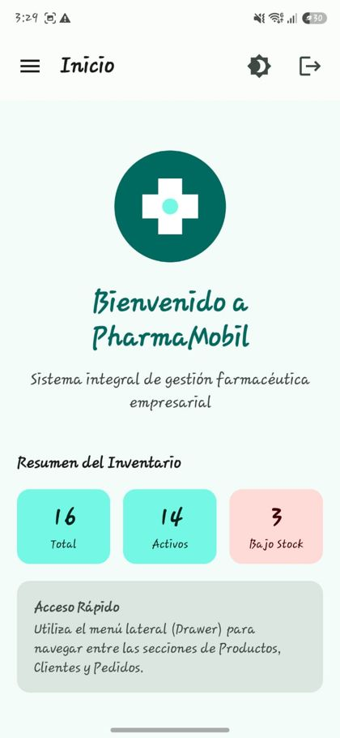
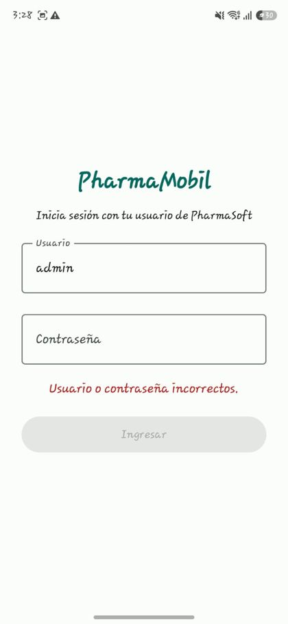
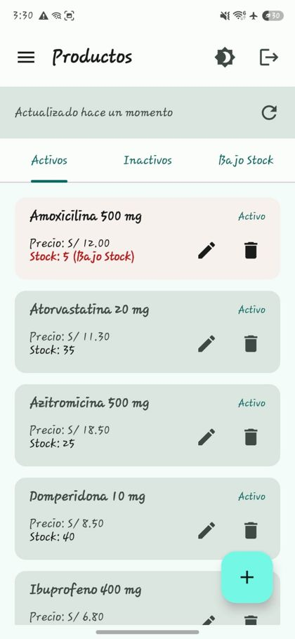
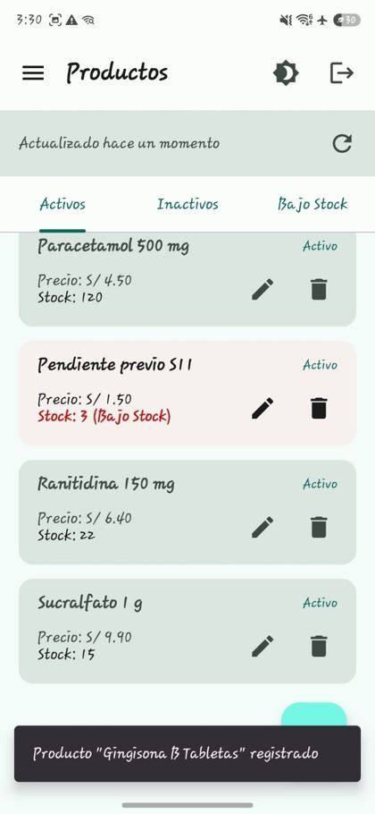
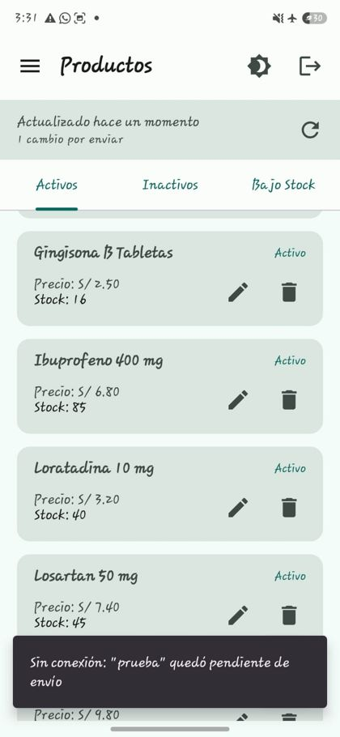
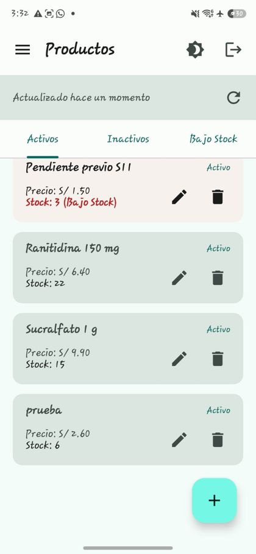
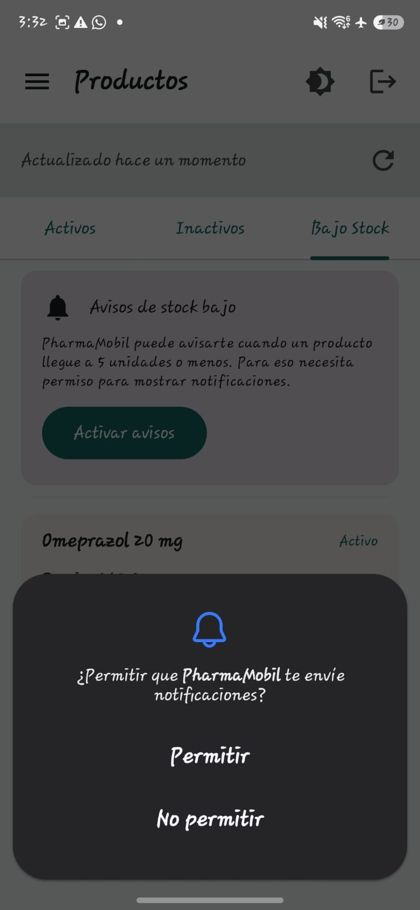
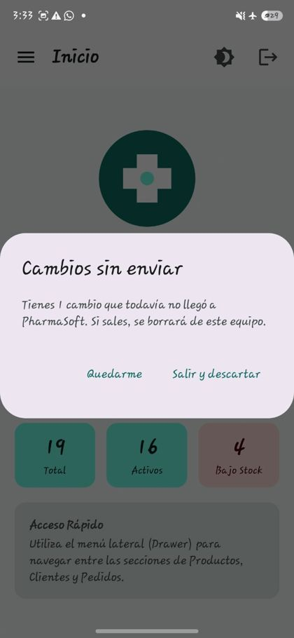

# PharmaMobil 1.0.0 · Guía de instalación y uso

Para quien no conoce el proyecto. Tiempo estimado: 30–40 minutos.

## 1. Requisitos (versiones con las que se probó)

| Herramienta | Versión probada |
|---|---|
| Windows | 11 Home Single Language (10.0.26300) |
| Android Studio | AI-261.26222.65.2613.15948027 (incluye JDK 21 en `jbr`) |
| JDK del backend | Java 21.0.9 LTS |
| Gradle (wrapper del proyecto) | 9.1.0 |
| Android Gradle Plugin · Kotlin | 9.0.1 · 2.4.10 |
| Android mínimo del teléfono | 7.0 (API 24) · probado en Android 13 (API 33) y Android 16 (API 36) |
| Docker Desktop | Docker 29.9.3 |
| Base de datos | **Oracle Database Free** en Docker (`container-registry.oracle.com/database/free:latest`, Oracle AI Database Free 26ai 23.26.1). No PostgreSQL |
| Backend | PharmaSoft · Spring Boot 4.0.7 · Java 21 · Flyway |
| Xcode | No probado (ver «Instalar en iOS») |

## 2. Levantar el servicio

1. Clonar el backend: `git clone https://github.com/dreyna/pharmaSoft.git` (rama `master`, commit `fff44f9`, «seguridad»). Es el repositorio del curso; no se modificó.
2. Base de datos y servicio, desde la carpeta del backend:
   ```powershell
   docker start oracle-local          # contenedor Oracle Free, puerto 1522 del PC -> 1521 del contenedor
   .\mvnw.cmd spring-boot:run         # PharmaSoft en el puerto 8080
   ```
   - Usuario `PHARMADB` en `FREEPDB1`, puerto 1522 (`application-dev.yaml`).
   - Flyway crea el esquema y los datos iniciales en el primer arranque (V1–V3).
   - Primera vez, si el contenedor no existe (reconstruido a partir de `docker inspect` del contenedor del equipo: imagen, puerto y variable `ORACLE_PWD`; sin volumen, por lo que los datos viven dentro del contenedor y se pierden si se elimina):
     ```powershell
     docker run -d --name oracle-local -p 1522:1521 -e ORACLE_PWD=<clave del administrador> container-registry.oracle.com/database/free:latest
     ```
     Oracle tarda unos minutos en quedar listo (`docker ps` debe mostrar «healthy»).
   - El usuario `PHARMADB` no lo crea ninguna migración del backend: en el contenedor del equipo ya existía. En un contenedor nuevo hay que crearlo antes de arrancar PharmaSoft, con permisos sobre `FREEPDB1` y la contraseña que figura en `application-dev.yaml` del backend.
3. Comprobar: `http://localhost:8080/api/health` responde «Backend funcionando correctamente»; Swagger en `http://localhost:8080/swagger-ui.html`.
4. Abrir el puerto en el cortafuegos (PowerShell como administrador, una sola vez):
   `New-NetFirewallRule -DisplayName "PharmaSoft 8080" -Direction Inbound -Protocol TCP -LocalPort 8080 -Action Allow`

## 3. Datos de prueba

La migración `V3__datos_iniciales_seguridad.sql` crea tres usuarios de **prueba** (contraseñas públicas del backend del curso, no de producción):

| Usuario | Rol | Contraseña de prueba | Qué puede hacer |
|---|---|---|---|
| `admin` | ADMIN | `Admin123` | Todo |
| `vendedor` | VENDEDOR | `Vendedor123` | Ver el catálogo de productos; no puede crear, editar ni dar de baja |
| `almacen` | ALMACENERO | `Almacen123` | Ver y gestionar productos y stock |

No se puede entrar sin credenciales: el login las valida contra PharmaSoft, y un usuario o contraseña inventados dan «Usuario o contraseña incorrectos.». Hay que usar uno de los tres usuarios de la tabla.

Categoría usada por la app: «Analgésicos» (id 1), que la base inicial ya trae.

## 4. Instalar en Android

1. En el PC: *Configuración → Red e Internet → Zona con cobertura inalámbrica móvil* → **Activado**. Comprobar con `ipconfig` que el adaptador «Conexión de área local* N» tiene `192.168.137.1`. Si dice `192.168.137.2`, otro adaptador (por ejemplo VMware VMnet1) ocupa la `.1`: deshabilitarlo y volver a encender la zona.
2. Conectar el teléfono a esa red. En su navegador abrir `http://192.168.137.1:8080/api/health`: debe responder. Si no, el problema es de red, cortafuegos o Docker, no de la app.
3. Copiar `Equipo12_ProyectoFinal_Android.apk` al teléfono (cable USB o Drive) y abrirlo desde *Archivos*.
4. Permitir *Instalar apps desconocidas* para la app desde la que se abre; si Play Protect avisa, *Instalar de todas formas*. Si el teléfono ya tenía la versión de depuración, desinstalarla antes (la firma es distinta).
5. **Otra red** (router de casa): la URL va dentro del build. Hay que recompilar con `pharmasoft.url=http://<IP del PC>:8080/api/v1/` en `local.properties` y agregar esa IP en `androidApp/src/main/res/xml/network_security_config.xml`.

## 5. Instalar en iOS

No se probó: el equipo no dispone de Mac. Pasos y evidencia alternativa en `docs/ios-14.md`.

## 6. Recorrido guiado

| Pantalla | Qué hacer | Qué se espera ver |
|---|---|---|
| Login | `admin` / `Admin123` | Pantalla de inicio con el resumen del inventario |
| Login (error) | `admin` con una clave incorrecta | «Usuario o contraseña incorrectos.» |
| Productos | Abrir desde el menú | Lista de PharmaSoft y «Actualizado hace un momento» |
| Nuevo producto | Botón + → completar → Registrar | Aparece en la lista con estado «Activo» |
| Modo avión | Con la sesión ya iniciada, activar el modo avión del teléfono y crear otro producto | La app no se bloquea: el producto se guarda en el teléfono con «Pendiente de envío» y la barra dice «1 cambio por enviar». Solo el primer login exige conexión |
| Volver la red | Desactivar el modo avión y reconectar a la zona con cobertura | Se sincroniza; el pendiente toma su id real |
| Bajo Stock | Pestaña → *Activar avisos* → Permitir | Se concede el permiso de notificaciones |
| Cerrar sesión | Icono de salir | Si hay pendientes, pregunta «Cambios sin enviar»; luego vuelve al login. No hace falta cerrar la aplicación: con la red de vuelta se puede iniciar sesión de nuevo sin salir de ella |

Capturas del recorrido, tomadas el 11-11-2026 en el Samsung Galaxy A56 5G de Jeanpierre (Android 16):

| N.º | Pantalla | Captura |
|---|---|---|
| A-01 | Inicio tras el login con `admin` |  |
| A-02 | Login con clave incorrecta |  |
| A-03 | Lista de productos |  |
| A-04 | Nuevo producto registrado |  |
| A-05 | Modo avión: «Pendiente de envío» |  |
| A-06 | Red de vuelta: sincronizado |  |
| A-07 | Bajo Stock: solicitud del permiso de notificaciones (solo el aviso del sistema; no se capturó el estado concedido) |  |
| A-08 | Cerrar sesión con un pendiente |  |

## 7. Problemas frecuentes

| Síntoma | Causa | Solución |
|---|---|---|
| No puedo iniciar sesión y el teléfono no está en el internet de la laptop | El login necesita llegar a PharmaSoft, que corre en el PC; no hace falta internet general, pero sí estar en la red de la zona con cobertura del PC | Conectar el teléfono a esa red y comprobar `/api/health` en su navegador |
| «Sin conexión con el servidor» en el login, con Wi-Fi | El teléfono no llega al PC | Probar `/api/health` en el navegador del teléfono; activar la regla del cortafuegos; usar la zona con cobertura (la Wi-Fi de la universidad aísla equipos) |
| El navegador del teléfono tarda y no responde | El teléfono no está en la red de la zona con cobertura, o los datos móviles tomaron el control | Conectar a la red del PC; desactivar los datos móviles mientras se prueba |
| La IP del PC es `192.168.137.2` | VMware VMnet1 ocupa la `.1` | Deshabilitar el adaptador (`Disable-NetAdapter -Name "VMware Network Adapter VMnet1"`) y reiniciar la zona |
| «La app no se instaló» | Había una versión de depuración con otra firma | Desinstalar y volver a instalar |
| `CLEARTEXT communication … not permitted` en Logcat | La IP del PC no está en `network_security_config.xml` | Agregarla y recompilar |
| Avisos de stock «bloqueados» | Se negó el permiso de notificaciones dos veces | *Abrir Ajustes* → Notificaciones de PharmaMobil |

## 8. Registro de la prueba por un tercero

| Probó | Equipo | Fecha | Pasos que tuvo que preguntar o no pudo seguir | Corrección hecha en la guía |
|---|---|---|---|---|
| Julio (ajeno al proyecto) | Sin equipo asignado | 11-11-2026, 16:17 a 16:25 | **No siguió esta versión de la guía A** (redactada el 13-11-2026): siguió el recorrido de 8 pasos de la Guía Práctica N.º 14, vigente ese día. Instaló y probó el APK en su Samsung Galaxy A12 (Android 13); sus capturas están en el Producto C. Las preguntas y sugerencias las hizo después, tras experimentar por su cuenta con la app (según relato de Jeanpierre): 1) «¿Se puede iniciar sin credenciales?» (probó un usuario y clave sin que se las dieran; luego recibió las de `admin` y entró); 2) «¿Necesito internet para loguearme?» (no estaba en la red del PC y no pudo entrar); 3) «¿Qué pasa luego de poner el modo avión?» (se le indicó activarlo, como en la prueba de la GP); 4) «¿Por qué tengo que salir de la aplicación luego de cerrar sesión?» (la indicación decía salir; se le pidió probar reconectándose sin salir y entró normal) | 13-11-2026, a partir de esas preguntas: aviso de credenciales en §3; fila de login sin red en §7; el modo avión y el cierre de sesión aclarados en §6 (no hace falta cerrar la aplicación) |
| Julio (ajeno al proyecto) | Sin equipo asignado | <fecha real> | *Pendiente: prueba siguiendo esta guía, sin ayuda* | *Pendiente* |
